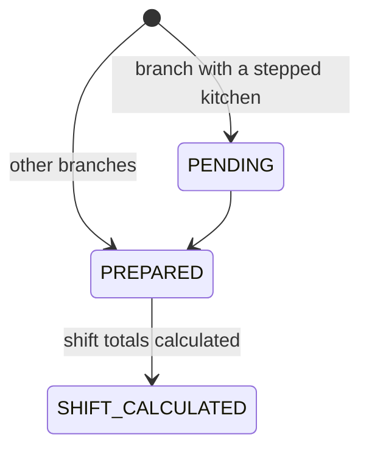
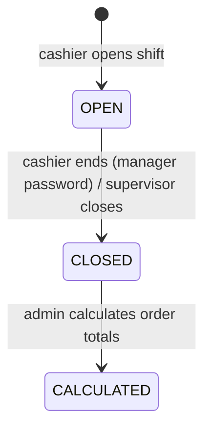

# 🍽️ Restaurant POS — Backend API

REST API for a multi-branch restaurant point-of-sale system. It powers cashier, call-center, manager, and admin screens: menu management, orders (dine-in, takeaway, delivery), customers and delivery regions, cashier shifts, and branch sales statistics with printable reports.


## ✨ Features

- **Multi-branch menu**: categories and items, with per-branch availability and price overrides.
- **Orders**: dine-in, takeaway, and delivery. Each order stores a price snapshot. The server recalculates the subtotal, service fee, and delivery fee, and rejects totals that don't match what the POS sent. Orders are created in a transaction with pessimistic row locks.
- **Customers and delivery regions**: phone lookup for the call center, and a delivery price per region.
- **Cashier shifts**: open and end a shift (ending needs a manager's password), supervisor close, and shift total calculation.
- **Statistics and printing**: manager dashboard KPIs, shift order reports, branch KPIs, and summary print endpoints, with branch scoping per role.
- **Role-based access**: JWT auth with a `@Roles()` guard on every endpoint.

## 👥 Roles

| Role | What they can do |
|---|---|
| `ADMIN` | Manages everything: branches, menu, users, delivery regions, all shifts and statistics |
| `MANAGER` | Shifts, statistics, and customers for their own branch only |
| `CASHIER` | Creates orders, opens and ends their own shift |
| `CALLCENTER` | Finds and manages customers by phone |
| `USER` | Read-only access to the menu and branches |

## 🧱 Architecture

```
src/
├── app/modules/          # Feature modules: controller, service, entity, mapper, DTOs, specs
│   ├── auth/             # Login and JWT issuing
│   ├── branch/           # Branches (dine-in / takeaway)
│   ├── menu-category/    # Menu categories
│   ├── menu-item/        # Menu items and branch pricing
│   ├── order/            # Orders, order items, totals validation
│   ├── customer/         # Customers, phone lookup
│   ├── delivery-region/  # Delivery areas and fees
│   ├── shift-management/ # Cashier shifts lifecycle
│   ├── statistics/       # Dashboard and print reports
│   └── user/             # Users and roles
├── core/                 # Enums, security (JWT strategy, guards, decorators), utils
└── database/             # TypeORM migrations and seeders
```

- All routes are under `/api/v1` (URI versioning) and use global `ValidationPipe` DTO validation.
- The schema is managed with TypeORM **migrations** (24 so far). Seeders create users and a sample restaurant menu.
- The API is documented in a **Postman collection** in [`postman/`](postman), and the manager and statistics flows have a frontend guide in [`docs/`](docs).

### Order lifecycle



### Shift lifecycle



## 🚀 Getting Started

**Requirements:** Node.js 22+, pnpm, Docker

```bash
pnpm install
cp .env.example .env.development   # then fill in APP_SECRET_KEY and DB settings
pnpm run dev:db                    # starts Postgres in Docker, builds, seeds, and runs in watch mode
```

The API runs at `http://localhost:8080/api/v1`.

**Full stack with Docker** (API, Nginx, and Postgres):

```bash
cp .env.docker.example .env.docker
docker compose -f docker-compose.full.yml --env-file .env.docker up --build
```

## 🧪 Tests

```bash
pnpm test        # unit tests (services, controllers, mappers)
pnpm test:e2e    # end-to-end POS scenarios
```

## 📄 License

UNLICENSED — portfolio project.
